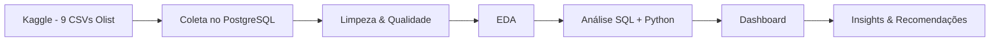
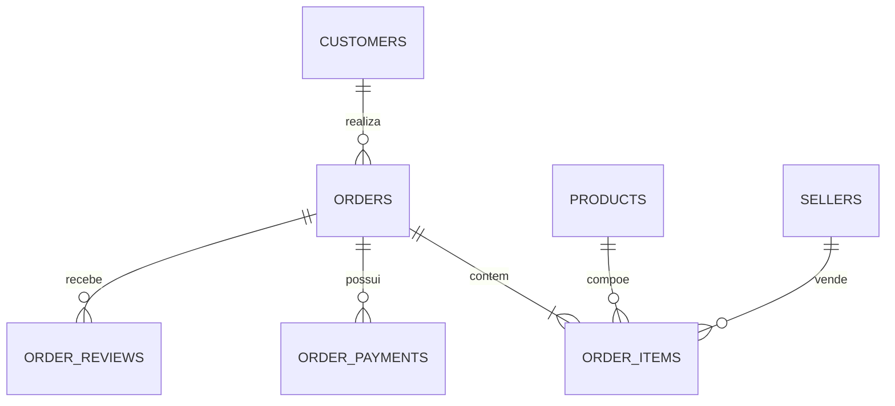
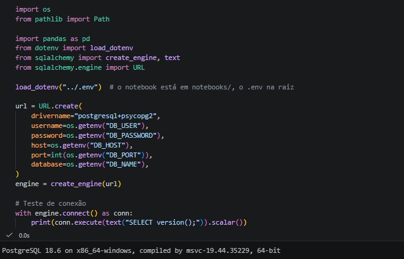
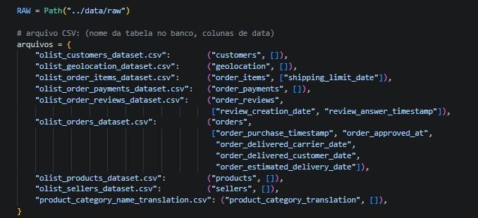
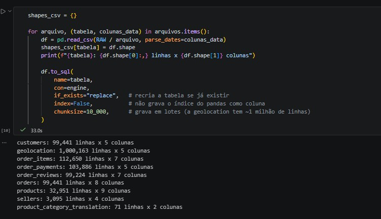

# 📦 Entregas Atrasadas e Satisfação do Cliente — Análise End-to-End do E-commerce Olist


<!-- Troque os badges pelas ferramentas que você realmente usar. Quando terminar, mude o status para "concluído". -->

> **Resumo em uma frase:** [Preencher ao final. Modelo: "Análise de ~99 mil pedidos do marketplace Olist (2016–2018) que mediu o quanto os atrasos de entrega derrubam a nota de avaliação e identificou os estados e categorias com maior risco logístico."]

---

## 🎯 Objetivo

Medir o impacto dos atrasos de entrega na satisfação dos clientes (nota de avaliação) e na recompra, identificando **onde** (estados, categorias, vendedores) e **quando** (meses, sazonalidade) o problema se concentra, para apoiar decisões de logística e de gestão de vendedores.

Neste projeto, realizei uma análise de dados completa, que consiste nas seguintes etapas:
1. Coleta e carga dos dados do Kaggle (9 arquivos CSV do Olist) em um banco PostgreSQL.
2. Limpeza, tratamento e validação da qualidade dos dados.
3. Análise exploratória (EDA) para entender distribuições, padrões e anomalias.
4. Análise aprofundada para responder às perguntas de negócio.
5. Construção de dashboard / visualizações para comunicar os resultados.
6. Consolidação de insights e recomendações acionáveis.

> **Foco do projeto:** ênfase em SQL (joins entre várias tabelas), análise e storytelling com dados.

## 💼 Contexto de Negócio

- **Problema:** Em marketplaces, a experiência de entrega pesa muito na avaliação do cliente. A diretoria suspeita que atrasos em relação ao prazo prometido estão reduzindo as notas e prejudicando a reputação da plataforma, mas não sabe o tamanho do problema nem onde ele está concentrado.
- **Público-alvo:** Diretoria de operações e logística, time de gestão de vendedores (sellers) e time de experiência do cliente.
- **Impacto esperado:** Priorizar ações (renegociar prazos, acompanhar vendedores críticos, ajustar a promessa de entrega por região) nos pontos onde o atraso mais prejudica a satisfação.

## ❓ Perguntas de Negócio

| # | Pergunta | Métrica / KPI associado |
|---|----------|--------------------------|
| 1 | Qual é a taxa de pedidos entregues com atraso e como ela evolui ao longo do tempo? | % de pedidos atrasados |
| 2 | Quanto o atraso reduz a nota de avaliação do cliente? | Nota média (review score) por faixa de atraso |
| 3 | Quais estados concentram mais atrasos e pior tempo de entrega? | % de atraso e dias de entrega por UF |
| 4 | Quais categorias de produto têm pior experiência de entrega? | % de atraso e nota média por categoria |
| 5 | Existem vendedores que concentram atrasos de forma recorrente? | % de atraso por vendedor (com volume mínimo) |
| 6 | O atraso afeta a receita? (frete, ticket médio e recompra) | Ticket médio, valor do frete, taxa de recompra |

<!-- Esta seção é o coração de um projeto de análise: ela guia tudo o que vem depois. -->

---

## 📑 Table of Contents

- [Objetivo](#-objetivo)
- [Contexto de Negócio](#-contexto-de-negócio)
- [Perguntas de Negócio](#-perguntas-de-negócio)
- [Dataset Used](#-dataset-used)
- [Technologies](#-technologies)
- [Project Workflow](#-project-workflow)
- [Estrutura do Repositório](#-estrutura-do-repositório)
- [Data Modeling](#-data-modeling)
- [Step 1: Coleta](#step-1-coleta)
- [Step 2: Limpeza e Qualidade dos Dados](#step-2-limpeza-e-qualidade-dos-dados)
- [Step 3: Análise Exploratória (EDA)](#step-3-análise-exploratória-eda)
- [Step 4: Análise e Modelagem](#step-4-análise-e-modelagem)
- [Step 5: Dashboard](#step-5-dashboard)
- [Resultados e Insights](#-resultados-e-insights)
- [Recomendações](#-recomendações)
- [Limitações e Premissas](#-limitações-e-premissas)
- [Próximos Passos](#-próximos-passos)
- [Como Reproduzir](#-como-reproduzir)
- [Autor](#-autor)

---

## 📦 Dataset Used

O **Brazilian E-Commerce Public Dataset by Olist** reúne pedidos reais e anonimizados feitos na Olist, empresa que conecta pequenos negócios a grandes marketplaces brasileiros. Os dados cobrem o ciclo completo do pedido: status e datas, itens, preços e frete, pagamentos, avaliações dos clientes, produtos, vendedores e localização.

| Item | Detalhe |
|------|---------|
| **Fonte** | Kaggle — Olist (`olistbr/brazilian-ecommerce`) |
| **Período coberto** | 2016 a 2018 |
| **Volume** | ~100 mil pedidos (99.441 na tabela `orders`), distribuídos em 9 tabelas relacionadas |
| **Granularidade** | Varia por tabela: 1 linha = 1 pedido (`orders`), 1 item do pedido (`order_items`), 1 pagamento, 1 avaliação etc. |
| **Formato** | CSV (9 arquivos) |
| **Licença / Uso** | CC BY-NC-SA 4.0 (uso não comercial, com atribuição e mesma licença — adequado para portfólio) |
| **Dados sensíveis (LGPD)?** | Dados anonimizados pela Olist (nomes de lojas/parceiros substituídos por nomes de casas de Game of Thrones; sem dados pessoais diretos). [Confirmar na ingestão que não há campos identificáveis] |

**Links úteis:**
- Fonte oficial: https://www.kaggle.com/datasets/olistbr/brazilian-ecommerce
- Dicionário de dados: descrito na página do dataset no Kaggle (aba *Data*)
- Dados brutos: baixar pelo Kaggle (requer login gratuito) e salvar em `data/raw/`

### Tabelas do dataset

| Tabela (arquivo) | O que contém |
|------------------|--------------|
| `olist_orders_dataset` | Tabela central: status e datas de cada pedido |
| `olist_order_items_dataset` | Itens de cada pedido: produto, vendedor, preço e frete |
| `olist_order_payments_dataset` | Formas e valores de pagamento |
| `olist_order_reviews_dataset` | Notas e comentários dos clientes |
| `olist_customers_dataset` | Cliente e localização (cidade/UF) |
| `olist_sellers_dataset` | Vendedores e localização |
| `olist_products_dataset` | Categoria, peso e dimensões dos produtos |
| `olist_geolocation_dataset` | CEP × latitude/longitude |
| `product_category_name_translation` | Tradução das categorias (PT → EN) |

### Dicionário de Dados (principais colunas usadas)

| Coluna | Tipo | Descrição |
|--------|------|-----------|
| `order_id` | string | Identificador único do pedido |
| `customer_id` | string | Identificador do cliente **por pedido** (o mesmo cliente recebe ids diferentes em pedidos diferentes) |
| `customer_unique_id` | string | Identificador único do cliente (usar para análise de recompra) |
| `order_status` | string | Status do pedido (entregue, cancelado, enviado etc.) |
| `order_purchase_timestamp` | datetime | Data/hora da compra |
| `order_delivered_customer_date` | datetime | Data real de entrega ao cliente |
| `order_estimated_delivery_date` | datetime | Prazo de entrega prometido ao cliente |
| `review_score` | int | Nota da avaliação (1 a 5) |
| `price` / `freight_value` | float | Preço do item e valor do frete |
| `customer_state` / `seller_state` | string | UF do cliente / do vendedor |
| `product_category_name` | string | Categoria do produto (em português) |

<!-- Revise esta tabela com o dicionário oficial ao carregar os dados e ajuste nomes/tipos se necessário. -->

## 🛠️ Technologies

- **Linguagens:** Python, SQL
- **Bibliotecas:** pandas, NumPy, Matplotlib, Seaborn, Plotly, SQLAlchemy
- **Ambiente:** Jupyter Notebook / VS Code
- **Banco de Dados:** PostgreSQL
- **Dashboard:** Power BI
- **Versionamento:** Git e GitHub

## 🔄 Project Workflow


Arquivos por etapa:
- **Step 1 — Coleta:** [`notebooks/01_coleta.ipynb`](notebooks/01_coleta.ipynb)
- **Step 2 — Limpeza:** [`notebooks/02_limpeza.ipynb`](notebooks/02_limpeza.ipynb)
- **Step 3 — EDA:** [`notebooks/03_eda.ipynb`](notebooks/03_eda.ipynb)
- **Step 4 — Análise:** [`notebooks/04_analise.ipynb`](notebooks/04_analise.ipynb) e [`sql/analises.sql`](sql/analises.sql)
- **Step 5 — Dashboard:** [`dashboard/`](dashboard/)

## 📁 Estrutura do Repositório

```
.
├── data/
│   ├── raw/            # dados brutos (nunca editar; não versionar os CSVs)
│   └── processed/      # dados tratados
├── notebooks/          # análises em Jupyter
├── sql/                # queries utilizadas
├── dashboard/          # arquivos e prints do dashboard
├── images/             # gráficos e imagens usados no README
├── requirements.txt    # dependências
└── README.md
```

## 🧩 Data Modeling

O dataset já é relacional. A tabela `orders` é o centro do modelo e se conecta às demais por chaves, conforme o esquema abaixo (relações principais):



---

## Step 1: Coleta

Download manual dos 9 CSVs no Kaggle e carga no PostgreSQL (via pandas + SQLAlchemy).

1. Conectar o Banco de dados ao Notebook


2. Organizar e Mapear os Arquivos CSV


3. Importar ao Banco de Dados



## Step 2: Limpeza e Qualidade dos Dados

Diagnóstico inicial e tratamentos realizados:

| Problema encontrado | Quantidade / % | Tratamento aplicado |
|---------------------|----------------|----------------------|
| Colunas de data como texto | [a verificar] | Converter para datetime |
| Pedidos sem data de entrega ao cliente | [a verificar] | [Ex.: excluir da análise de atraso, pois não foram entregues] |
| Pedidos cancelados / indisponíveis | [a verificar] | [Ex.: filtrar `order_status = 'delivered'` nas análises de entrega] |
| Valores nulos em categoria de produto | [a verificar] | [definir tratamento] |
| Pedidos com mais de uma avaliação | [a verificar] | [definir regra: ex. manter a mais recente] |
| Linhas duplicadas | [a verificar] | [definir tratamento] |
| Outliers em tempo de entrega | [a verificar] | [removidos / mantidos e sinalizados] |

**Decisões importantes:** [Explique o *porquê* das escolhas, não apenas o quê. Ex.: por que considerou apenas pedidos entregues; como definiu "atraso".]

**Definição de atraso adotada:** entrega real (`order_delivered_customer_date`) posterior ao prazo prometido (`order_estimated_delivery_date`).

- Shape final: **[linhas × colunas]**
- Script/Notebook: [`notebooks/02_limpeza.ipynb`](notebooks/02_limpeza.ipynb)

## Step 3: Análise Exploratória (EDA)

Principais verificações a realizar:
- Estatísticas descritivas das variáveis numéricas (preço, frete, dias de entrega)
- Distribuição das variáveis (histogramas / boxplots)
- Frequência das variáveis categóricas (status, categoria, UF)
- Correlações entre variáveis (ex.: frete × tempo de entrega × nota)
- Análise temporal (tendências e sazonalidade, incluindo picos como a Black Friday de 2017)


**O que a EDA revelou:**
- [Achado 1]
- [Achado 2]
- [Achado 3]

## Step 4: Análise e Modelagem

Análises realizadas para responder às perguntas de negócio:

### 4.1 Qual a taxa de atraso e como evolui no tempo?

```sql
SELECT
    DATE_TRUNC('month', order_purchase_timestamp) AS mes,
    COUNT(*) AS pedidos_entregues,
    ROUND(100.0 * AVG(CASE
        WHEN order_delivered_customer_date > order_estimated_delivery_date THEN 1 ELSE 0
    END), 2) AS pct_atraso
FROM orders
WHERE order_status = 'delivered'
  AND order_delivered_customer_date IS NOT NULL
GROUP BY 1
ORDER BY 1;
```


**Leitura do resultado:** [O que o gráfico/tabela mostra e por que importa.]

### 4.2 Quanto o atraso reduz a nota de avaliação?

```sql
WITH pedidos AS (
    SELECT
        o.order_id,
        CASE
            WHEN o.order_delivered_customer_date <= o.order_estimated_delivery_date THEN '1. No prazo'
            WHEN o.order_delivered_customer_date - o.order_estimated_delivery_date <= INTERVAL '3 days' THEN '2. Atraso de 1 a 3 dias'
            WHEN o.order_delivered_customer_date - o.order_estimated_delivery_date <= INTERVAL '7 days' THEN '3. Atraso de 4 a 7 dias'
            ELSE '4. Atraso acima de 7 dias'
        END AS faixa_atraso
    FROM orders o
    WHERE o.order_status = 'delivered'
      AND o.order_delivered_customer_date IS NOT NULL
)
SELECT
    p.faixa_atraso,
    COUNT(*) AS avaliacoes,
    ROUND(AVG(r.review_score), 2) AS nota_media
FROM pedidos p
JOIN order_reviews r ON r.order_id = p.order_id
GROUP BY p.faixa_atraso
ORDER BY p.faixa_atraso;
```


**Leitura do resultado:** [...]

### 4.3 Estados, categorias e vendedores com maior concentração de atraso

[Repita a estrutura: query/código → visual → leitura do resultado. Para vendedores, definir volume mínimo de pedidos para evitar conclusões com amostras pequenas.]

### 4.4 Análise estatística — opcional

<!-- Sugestões: teste de hipótese (nota média com vs. sem atraso), correlação entre dias de atraso e nota, segmentação de clientes (RFM) e taxa de recompra. -->

- **Método:** [ex.: teste t / Mann-Whitney, correlação de Spearman]
- **Métricas de avaliação:** [ex.: p-value, tamanho do efeito]
- **Conclusão:** [resultado em linguagem simples]

## Step 5: Dashboard

[Link para o dashboard publicado.](https://link-do-dashboard)


**Principais KPIs exibidos:** % de pedidos atrasados, nota média, tempo médio de entrega, receita total
**Filtros disponíveis:** período, UF do cliente, categoria de produto

---

## 💡 Resultados e Insights

<!-- Preencher somente com o que os dados mostrarem. Seja específico e use números. -->

| # | Insight | Evidência (dado) | Impacto de negócio |
|---|---------|------------------|--------------------|
| 1 | [Insight] | [Número] | [Impacto] |
| 2 | [Insight] | [Número] | [Impacto] |
| 3 | [Insight] | [Número] | [Impacto] |

**Resumo executivo (TL;DR):**
- 🔹 [Conclusão principal 1]
- 🔹 [Conclusão principal 2]
- 🔹 [Conclusão principal 3]

## ✅ Recomendações

1. **[Ação recomendada]** — [justificativa baseada nos dados].
2. **[Ação recomendada]** — [justificativa baseada nos dados].
3. **[Ação recomendada]** — [justificativa baseada nos dados].

## ⚠️ Limitações e Premissas

- Os dados cobrem apenas 2016–2018 e 2016 tem volume muito baixo, o que limita a análise de sazonalidade e de tendência.
- O dataset é de um único marketplace/ecossistema (Olist); resultados não generalizam para todo o e-commerce brasileiro.
- Atraso foi medido contra o prazo prometido, não contra o tempo "ideal" de entrega.
- Correlação não implica causalidade: notas baixas podem ter outras causas além do atraso (qualidade do produto, produto divergente etc.).
- [Adicionar decisões de limpeza que possam afetar os números, ex.: critério de outliers.]

## 🚀 Próximos Passos

- [ ] Analisar os comentários de texto das avaliações para identificar outros motivos de insatisfação (NLP)
- [ ] Criar modelo preditivo de risco de atraso por pedido
- [ ] Cruzar com o *Marketing Funnel by Olist* (outro dataset público da empresa)
- [ ] Automatizar a atualização do dashboard

## ▶️ Como Reproduzir

```bash
# 1. Clone o repositório
git clone https://github.com/seu-usuario/seu-repositorio.git
cd seu-repositorio

# 2. Crie e ative um ambiente virtual
python -m venv venv
source venv/bin/activate      # Windows: venv\Scripts\activate

# 3. Instale as dependências
pip install -r requirements.txt

# 4. Baixe os dados do Kaggle e coloque os 9 CSVs em data/raw/
# https://www.kaggle.com/datasets/olistbr/brazilian-ecommerce

# 5. Execute os notebooks na ordem 01 → 04
jupyter notebook
```

## 👤 Autor

**[Seu Nome]**
Analista de Dados | [Sua área de interesse]

- 💼 LinkedIn: [link]
- 🐙 GitHub: [link]
- 📧 E-mail: [email]

---


