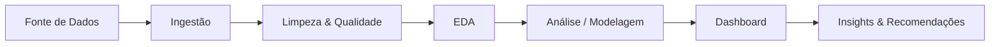

# 📊 [Nome do Projeto] — Análise de Dados End-to-End

<!-- Dica: título curto e descritivo. Ex.: "Análise de Churn de Clientes — Telecom" -->


<!-- Troque os badges pelas ferramentas que você realmente usou. Status: em andamento | concluído -->

> **Resumo em uma frase:** [O que você analisou, para quem e qual foi a principal conclusão. Ex.: "Análise de 1,2 milhão de corridas de táxi em NYC que identificou os horários e regiões com maior receita por viagem."]

---

## 🎯 Objetivo

[2 a 4 linhas explicando o propósito do projeto.]

Neste projeto, realizei uma análise de dados completa, que consiste nas seguintes etapas:
1. Coleta e carga dos dados de [fonte].
2. Limpeza, tratamento e validação da qualidade dos dados.
3. Análise exploratória (EDA) para entender distribuições, padrões e anomalias.
4. Análise aprofundada para responder às perguntas de negócio.
5. Construção de dashboard / visualizações para comunicar os resultados.
6. Consolidação de insights e recomendações acionáveis.

> **Foco do projeto:** [Ex.: "ênfase em análise e storytelling com dados, com menor foco em engenharia de dados."]

## 💼 Contexto de Negócio

- **Problema:** [Qual dor ou decisão motivou a análise?]
- **Público-alvo:** [Quem usaria esses resultados? Ex.: time comercial, diretoria, operações]
- **Impacto esperado:** [Que decisão ou ação esta análise pode apoiar?]

## ❓ Perguntas de Negócio

| # | Pergunta | Métrica / KPI associado |
|---|----------|--------------------------|
| 1 | [Ex.: Quais são os 10 principais locais de embarque?] | Nº de viagens |
| 2 | [Ex.: Como a receita varia por hora do dia?] | Tarifa média |
| 3 | [Ex.: Qual forma de pagamento predomina?] | % de viagens |

<!-- Esta seção é o coração de um projeto de análise: ela guia tudo o que vem depois. -->

---

## 📑 Table of Contents

- [Objetivo](#-objetivo)
- [Contexto de Negócio](#-contexto-de-negócio)
- [Perguntas de Negócio](#-perguntas-de-negócio)
- [Dataset Used](#-dataset-used)
- [Technologies](#-technologies)
- [Project Workflow](#-project-workflow)
- [Estrutura do Repositório](#-estrutura-do-repositório)
- [Data Modeling](#-data-modeling-opcional)
- [Step 1: Coleta e Ingestão](#step-1-coleta-e-ingestão)
- [Step 2: Limpeza e Qualidade dos Dados](#step-2-limpeza-e-qualidade-dos-dados)
- [Step 3: Análise Exploratória (EDA)](#step-3-análise-exploratória-eda)
- [Step 4: Análise e Modelagem](#step-4-análise-e-modelagem)
- [Step 5: Dashboard](#step-5-dashboard)
- [Resultados e Insights](#-resultados-e-insights)
- [Recomendações](#-recomendações)
- [Limitações e Premissas](#-limitações-e-premissas)
- [Próximos Passos](#-próximos-passos)
- [Como Reproduzir](#-como-reproduzir)
- [Autor](#-autor)

---

## 📦 Dataset Used

[Descreva brevemente o dataset: o que ele representa e quais campos principais contém.]

| Item | Detalhe |
|------|---------|
| **Fonte** | [Nome da fonte / órgão / plataforma] |
| **Período coberto** | [Ex.: Jan/2023 a Dez/2023] |
| **Volume** | [Ex.: 1.2M linhas × 18 colunas] |
| **Granularidade** | [Ex.: 1 linha = 1 viagem] |
| **Formato** | [CSV, Parquet, API, banco SQL...] |
| **Licença / Uso** | [Ex.: dados públicos, licença CC0] |
| **Dados sensíveis (LGPD)?** | [Sim/Não — se sim, como foram tratados/anonimizados] |

**Links úteis:**
- Fonte oficial: [link]
- Dicionário de dados: [link]
- Dados brutos: [link ou instrução de download]

### Dicionário de Dados (principais colunas)

| Coluna | Tipo | Descrição |
|--------|------|-----------|
| `coluna_1` | datetime | [Descrição] |
| `coluna_2` | float | [Descrição] |
| `coluna_3` | string | [Descrição] |

## 🛠️ Technologies

- **Linguagens:** Python, SQL
- **Bibliotecas:** pandas, NumPy, Matplotlib, Seaborn, Plotly <!-- ajuste -->
- **Ambiente:** Jupyter Notebook / VS Code
- **Armazenamento / Banco:** [BigQuery, PostgreSQL, SQLite, CSV local...]
- **Visualização / BI:** [Power BI, Looker Studio, Tableau, Streamlit...]
- **Versionamento:** Git e GitHub
- **Outros (opcional):** [Excel, dbt, Airflow, Docker...]

## 🔄 Project Workflow

<!-- Insira aqui um diagrama simples do fluxo (pode ser feito no draw.io, Excalidraw ou Mermaid). -->



Arquivos por etapa:
- **Step 1 — Coleta:** [`notebooks/01_coleta.ipynb`](notebooks/01_coleta.ipynb)
- **Step 2 — Limpeza:** [`notebooks/02_limpeza.ipynb`](notebooks/02_limpeza.ipynb)
- **Step 3 — EDA:** [`notebooks/03_eda.ipynb`](notebooks/03_eda.ipynb)
- **Step 4 — Análise:** [`notebooks/04_analise.ipynb`](notebooks/04_analise.ipynb) e [`sql/analises.sql`](sql/analises.sql)
- **Step 5 — Dashboard:** [`dashboard/`](dashboard/)

## 📁 Estrutura do Repositório

```
.
├── data/
│   ├── raw/            # dados brutos (nunca editar)
│   └── processed/      # dados tratados
├── notebooks/          # análises em Jupyter
├── sql/                # queries utilizadas
├── dashboard/          # arquivos e prints do dashboard
├── images/             # gráficos e imagens usados no README
├── requirements.txt    # dependências
└── README.md
```

## 🧩 Data Modeling (opcional)

<!-- Use esta seção apenas se você organizou os dados em tabelas fato/dimensão ou criou um modelo relacional. Caso contrário, remova. -->

[Explique brevemente o modelo e insira o diagrama.]


---

## Step 1: Coleta e Ingestão

[Como os dados foram obtidos e carregados? Download manual, API, web scraping, consulta SQL?]

```python
import pandas as pd

df = pd.read_csv("data/raw/arquivo.csv")
df.head()
```

- Shape inicial: **[linhas × colunas]**
- Observações: [problemas já percebidos na carga, encoding, separadores etc.]

## Step 2: Limpeza e Qualidade dos Dados

Diagnóstico inicial e tratamentos realizados:

| Problema encontrado | Quantidade / % | Tratamento aplicado |
|---------------------|----------------|----------------------|
| Valores nulos em `coluna_x` | [ex.: 3,2%] | [ex.: preenchido com mediana] |
| Linhas duplicadas | [ex.: 1.540] | Removidas |
| Tipos incorretos (datas como texto) | [ex.: 2 colunas] | Convertidos para datetime |
| Outliers em `coluna_y` | [ex.: 0,8%] | [ex.: removidos via IQR / mantidos e sinalizados] |
| Inconsistências de categoria | [ex.: "NY", "N.Y."] | Padronizadas |

**Decisões importantes:** [Explique o *porquê* das escolhas, não apenas o quê. Isso mostra raciocínio analítico.]

- Shape final: **[linhas × colunas]**
- Script/Notebook: [link]

## Step 3: Análise Exploratória (EDA)

Principais verificações realizadas:
- Estatísticas descritivas das variáveis numéricas
- Distribuição das variáveis (histogramas / boxplots)
- Frequência das variáveis categóricas
- Correlações entre variáveis
- Análise temporal (tendências e sazonalidade)


**O que a EDA revelou:**
- [Achado 1]
- [Achado 2]
- [Achado 3]

## Step 4: Análise e Modelagem

Análises realizadas para responder às perguntas de negócio:

### 4.1 [Pergunta 1]

```sql
-- Exemplo
SELECT
    pickup_location,
    COUNT(*) AS total_viagens
FROM viagens
GROUP BY pickup_location
ORDER BY total_viagens DESC
LIMIT 10;
```


**Leitura do resultado:** [O que o gráfico/tabela mostra e por que importa.]

### 4.2 [Pergunta 2]

[Repita a estrutura: query/código → visual → leitura do resultado.]

### 4.3 [Análise estatística / modelo — opcional]

<!-- Se aplicável: teste de hipótese, regressão, segmentação (RFM, clusters), previsão, teste A/B etc. -->

- **Método:** [ex.: regressão linear, teste t, K-Means]
- **Métricas de avaliação:** [ex.: R², RMSE, p-value]
- **Conclusão:** [resultado em linguagem simples]

## Step 5: Dashboard

[Link para o dashboard publicado.](https://link-do-dashboard)


**Principais KPIs exibidos:** [KPI 1, KPI 2, KPI 3]
**Filtros disponíveis:** [período, região, categoria...]

---

## 💡 Resultados e Insights

<!-- A seção mais importante para quem lê seu portfólio. Seja específico e use números. -->

| # | Insight | Evidência (dado) | Impacto de negócio |
|---|---------|------------------|--------------------|
| 1 | [Ex.: O pico de receita ocorre entre 17h e 19h] | [Tarifa média 22% acima da média] | [Ajustar oferta de motoristas nesse horário] |
| 2 | [Insight] | [Número] | [Impacto] |
| 3 | [Insight] | [Número] | [Impacto] |

**Resumo executivo (TL;DR):**
- 🔹 [Conclusão principal 1]
- 🔹 [Conclusão principal 2]
- 🔹 [Conclusão principal 3]

## ✅ Recomendações

1. **[Ação recomendada]** — [justificativa baseada nos dados].
2. **[Ação recomendada]** — [justificativa baseada nos dados].
3. **[Ação recomendada]** — [justificativa baseada nos dados].

## ⚠️ Limitações e Premissas

- [Ex.: Os dados cobrem apenas 1 ano, o que limita a análise de sazonalidade.]
- [Ex.: Outliers foram removidos com critério X, o que pode afetar a média.]
- [Ex.: Correlação não implica causalidade.]

## 🚀 Próximos Passos

- [ ] [Ex.: Incluir dados de outros períodos]
- [ ] [Ex.: Criar modelo preditivo de demanda]
- [ ] [Ex.: Automatizar a atualização do dashboard]

## ▶️ Como Reproduzir

```bash
# 1. Clone o repositório
git clone https://github.com/seu-usuario/seu-repositorio.git
cd seu-repositorio

# 2. Crie e ative um ambiente virtual
python -m venv venv
source venv/bin/activate      # Windows: venv\Scripts\activate

# 3. Instale as dependências
pip install -r requirements.txt

# 4. Baixe os dados e coloque em data/raw/
# [instruções ou link]

# 5. Execute os notebooks na ordem 01 → 04
jupyter notebook
```

## 👤 Autor

**[Seu Nome]**
Analista de Dados | [Sua área de interesse]

- 💼 LinkedIn: [link]
- 🐙 GitHub: [link]
- 📧 E-mail: [email]

---

⭐ Se este projeto foi útil, deixe uma estrela no repositório!
